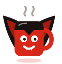
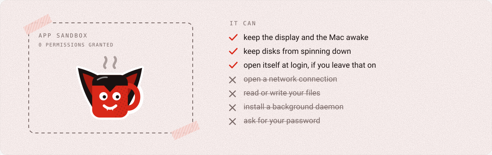

<div align="center">

<picture>
  <source media="(prefers-color-scheme: dark)" srcset="assets/mascot-dark.svg">
  
</picture>

# brewCula

**Keeps your Mac up all night. Click the mug and it stays awake. Click again and it can sleep.**

[](../../actions/workflows/build.yml)
[](../../releases)
[](LICENSE)
[](#install)
[](#it-cant-do-anything-else)
[](app/main.swift)

<picture>
  <source media="(prefers-color-scheme: dark)" srcset="assets/hero-dark.svg">
  
</picture>

**[Website →](https://dibakar01.github.io/brewcula/)**

</div>

---

## Install

```bash
curl -fsSL https://raw.githubusercontent.com/Dibakar01/brewcula/main/install.sh | sh
```

One line does all of it. It downloads the release, checks its SHA-256, puts
**brewCula.app** in `~/Applications`, turns on Open at Login (macOS 13 and later), and starts it. No
admin password. [Read the script first](install.sh); it is under 70 lines.

Then click the mug in your menu bar. Right-click it for how long it has been
awake, Open at Login, and Quit.

---

## It can't do anything else

<picture>
  <source media="(prefers-color-scheme: dark)" srcset="assets/sandbox-dark.svg">
  
</picture>

brewCula runs inside the macOS **App Sandbox with nothing granted**. That is
enforced by macOS, not promised in a README. Check it on your own copy:

```bash
codesign -d --entitlements - ~/Applications/brewCula.app
```

The only key it prints is `com.apple.security.app-sandbox`. No network, no
files, no helpers, no password prompts. It never runs `caffeinate` or a shell.
When it quits or crashes, macOS drops its power assertions with the process, so
it cannot leave your Mac stuck awake.

---

## How it works

It is `caffeinate -dims` in a menu bar. Same four power assertions, asked for
directly through IOKit instead of by spawning a process:

| `caffeinate` | Assertion | What it holds off |
|:--:|---|---|
| `-d` | `PreventUserIdleDisplaySleep` | the display dimming and sleeping |
| `-i` | `PreventUserIdleSystemSleep` | the Mac idling to sleep |
| `-m` | `PreventDiskIdle` | disks spinning down |
| `-s` | `PreventSystemSleep` | system sleep, on AC power only (a macOS rule) |

Watch them appear and disappear as you click:

```bash
pmset -g assertions | grep brewCula
```

The whole app is one Swift file, [`app/main.swift`](app/main.swift).

---

## Verify the download

The zip the installer fetches is built by GitHub Actions from the tagged source,
never on a laptop, and carries a signed build-provenance attestation.

```bash
gh attestation verify brewCula-1.0.0.zip --repo Dibakar01/brewcula
shasum -a 256 brewCula-1.0.0.zip    # equals SHA256SUMS on the release and SHA256 in install.sh
```

**It is not notarized.** That needs a paid Apple Developer account. `curl` does
not set the quarantine flag, so the installer opens the app without a Gatekeeper
prompt, and the pinned checksum is what guards it. If you download the zip in a
browser instead, macOS blocks it once: System Settings › Privacy & Security ›
Open Anyway.

---

## Build it yourself

```sh
git clone https://github.com/Dibakar01/brewcula && cd brewcula
./build.sh                                            # Xcode Command Line Tools, nothing else
build/brewCula.app/Contents/MacOS/brewCula --check    # sandboxed, 4 assertions taken and released
open build/brewCula.app
```

## Uninstall

```bash
curl -fsSL https://raw.githubusercontent.com/Dibakar01/brewcula/main/install.sh | sh -s -- --uninstall
```

Turns off Open at Login, quits it, and deletes the app.

---

## Notes

- **On battery, closing the lid still sleeps the Mac.** That is macOS, and no app should fight it.
- **No timers, schedules, or settings window, on purpose.** If you want those,
  [KeepingYouAwake](https://github.com/newmarcel/KeepingYouAwake) and
  [Amphetamine](https://apps.apple.com/app/amphetamine/id937984704) are good.
- The art is generated by [`assets/generate.py`](assets/generate.py), so light
  and dark cannot drift. The [website](site/) uses components from
  [React Bits](https://reactbits.dev). Those files in `site/src/bits` keep
  their own licence, MIT + Commons Clause, not this repo's MIT.
- See [SECURITY.md](SECURITY.md) and [CHANGELOG.md](CHANGELOG.md).

<div align="center">
<br>
<sub>MIT licensed. Made because <code>caffeinate</code> deserved a cape.</sub>
</div>
